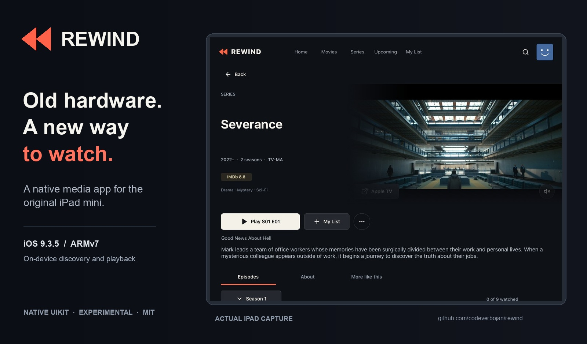
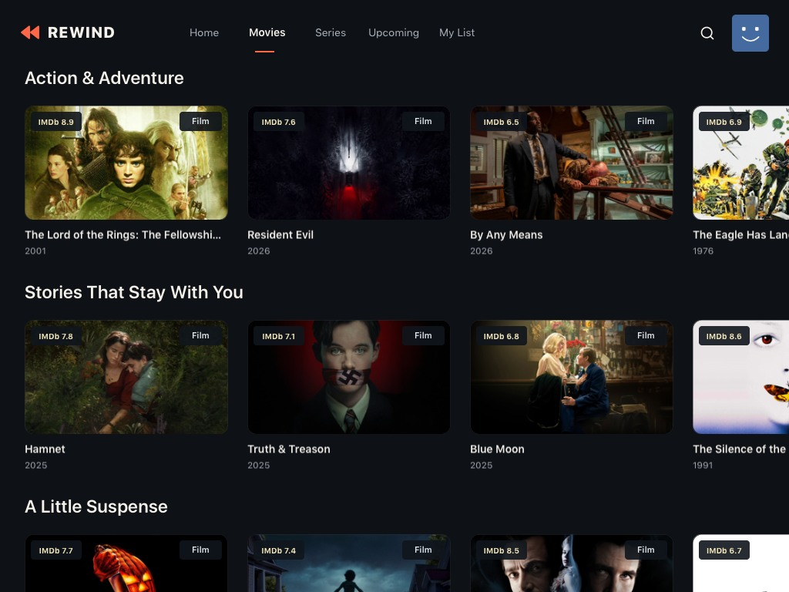
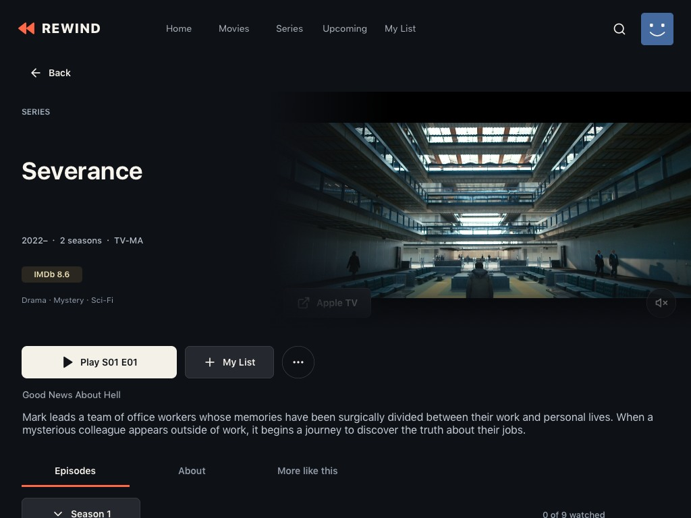
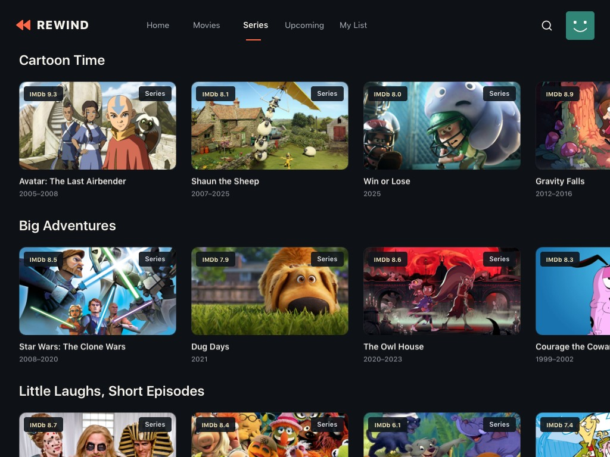
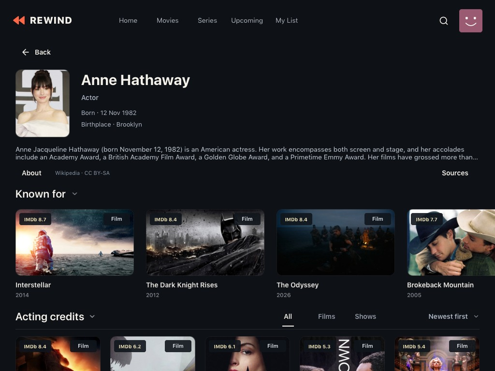
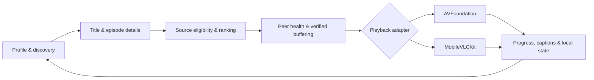

<p align="center">
  
</p>
<h1 align="center">Rewind</h1>
<p align="center"><strong>Old hardware. A new way to watch.</strong></p>
<p align="center">A native, standalone media app built for the original iPad mini.</p>
<p align="center">
  <a href="LICENSE"></a>
  
  
  
</p>
<p align="center">
  <a href="#a-look-inside">Interface</a> · <a href="#how-it-works">How it works</a> · <a href="docs/getting-started.md">Build & test</a> · <a href="docs/roadmap.md">Roadmap</a>
</p>



Rewind began with a question: **how much can a 2012 iPad still do with software built around its limits?** It grew into a complete media-app experiment: profiles, discovery, title and episode pages, local progress, native trailers, torrent transfers, audio selection and subtitles. The interface and playback run on the device; a Mac is used to build, sign, install and investigate the app.

This is a **source release**, not an App Store download. The legacy iPad build has been exercised on physical hardware. The separate ARM64 iPhone build compiles and packages, but runtime acceptance is still pending. See [supported targets and limitations](docs/status.md).

## A look inside

These are **real captures from the iPad app**, not interface mockups. They show earlier browsing checkpoints (0.156, 0.229 and 0.230); the latest iPad playback checkpoint is 0.300. Catalog artwork is illustrative and does not establish that a title is currently playable. [Capture details and attribution](docs/screenshots.md).

<table>
<tr>
<td width="50%"><a href="docs/assets/screenshots/movies.jpg"></a><br><strong>Browse by feeling</strong><br>Typed shelves, ratings and horizontal discovery.</td>
<td width="50%"><a href="docs/assets/screenshots/series-detail.jpg"></a><br><strong>Make a night of it</strong><br>Title details, in-app previews and episode navigation.</td>
</tr>
<tr>
<td><a href="docs/assets/screenshots/kids.jpg"></a><br><strong>A space for younger viewers</strong><br>Separate profiles and configurable age limits.</td>
<td><a href="docs/assets/screenshots/person.jpg"></a><br><strong>Follow the people behind the picture</strong><br>Cast, directors, studios and related work.</td>
</tr>
</table>

[See profiles, seasons and studios →](docs/screenshots.md)

## What it can do

- **Personal spaces:** a profile picker, different regular/Kids entrances, separate lists, viewing progress and preferences.
- **Discovery:** movie and series shelves, search, ratings, related titles, people and studio pages, with incremental loading and artwork caching.
- **Series continuity:** seasons, episodes, resume positions, followed shows and reminder logic.
- **A complete player:** play/pause, seeking, resume/start over, audio tracks, subtitles and subtitle timing controls. Tested multichannel fixtures downmix to stereo.
- **On-device streaming:** source eligibility and health evaluation, verified torrent reads, buffering, caching and cancellation, without a companion streaming server.
- **Designed around limited hardware:** native views, deferred work, bounded caches and close attention to lifecycle and main-thread costs.

Availability, metadata and trailer coverage depend on upstream services. Kids filtering depends on rating coverage. Subtitle synchronization and streaming startup still have open acceptance work; [the status page](docs/status.md) spells out those limits.

## How it works

**Choose a profile → discover a title → open its details → press Play → resume next time.**

On Play, Rewind evaluates source candidates against quality, device, storage and language policies. Torrent metadata and advertised seed counts are only hints: the engine also looks at connected peers, measured payload, verified pieces and buffered data before handing a source to a player. A well-listed torrent can still be slow or unavailable.



The primary app is Objective-C/UIKit, with Objective-C++ connecting to a C++ libtorrent engine. AVFoundation handles the native path; MobileVLCKit provides the alternate media path. [Architecture and code map →](docs/architecture.md)

## Get started

```sh
git clone https://github.com/codeverbojan/rewind.git
cd rewind
python3 tools/check_public_repo.py
python3 tools/run_portable_checks.py
```

These checks need Python 3 and, for the second command, a C++ compiler. They do not need an iPad, an Apple account, downloaded media or a running server. They cover repository hygiene and a small portable subset of existing engine policies—not the entire app.

Building an iOS app needs separately obtained SDKs, pinned native libraries, local data inputs and signing. The build scripts preserve the original research environment and are **not a one-command fresh-clone installer**. Start with the [build and installation guide](docs/getting-started.md).

| Target | Status |
| --- | --- |
| Original iPad mini · ARMv7 · iOS 9.3.5 | Physical-device research target; checkpoint 0.300 |
| iPhone · ARM64 | Separate 0.301 build; signing/launch and playback acceptance pending |
| Android, Windows, macOS, Linux | Porting assessment; no released ports |
| LG webOS | Feasibility depends on the television and platform version |

## Explore the project

- [Architecture](docs/architecture.md) — the main modules and playback path.
- [Build and installation](docs/getting-started.md) — dependencies, signing and test boundaries.
- [Current status](docs/status.md) — measured results, known gaps and version context.
- [Roadmap](docs/roadmap.md) — what remains and future platforms.
- [Contributing](CONTRIBUTING.md) — changes, bug reports and device safety.
- [Third-party notices](THIRD_PARTY_NOTICES.md) — code, media and data attribution.

## License

Original Rewind code and documentation are available under the [MIT license](LICENSE). Third-party code, libraries, fonts, catalog artwork and media retain their own terms. The public repository excludes personal device state, signing material, SDKs, downloaded commercial media and harvested catalog/ratings datasets. It does not grant rights to films or shows pictured in the interface.
