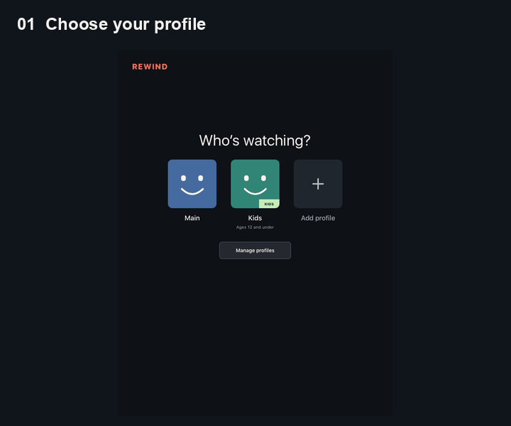
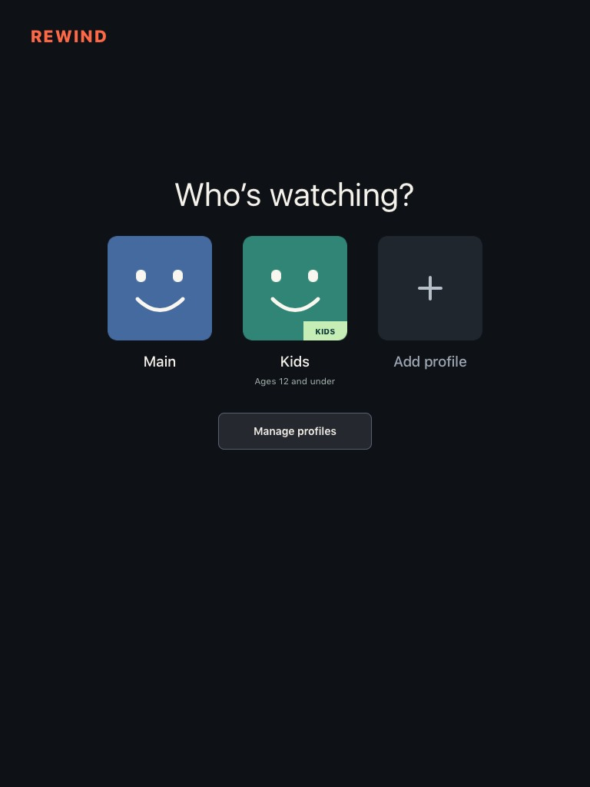
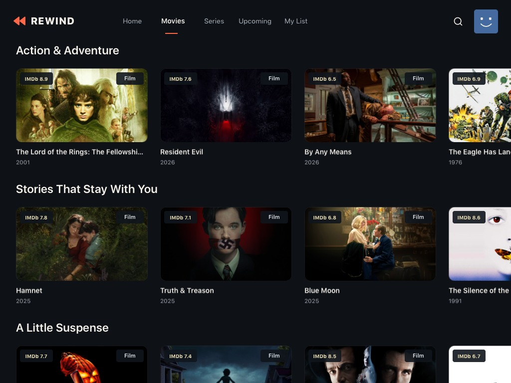
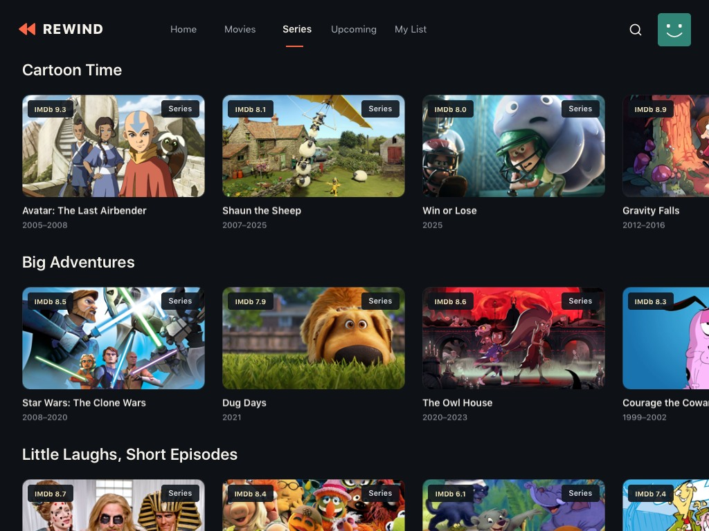
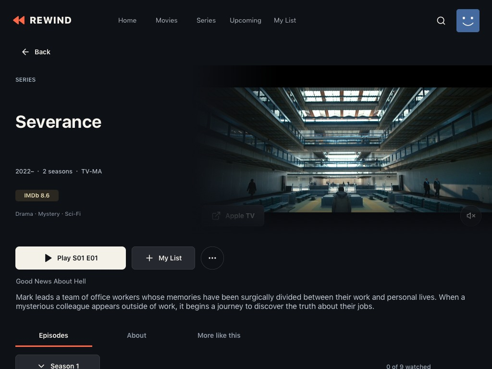
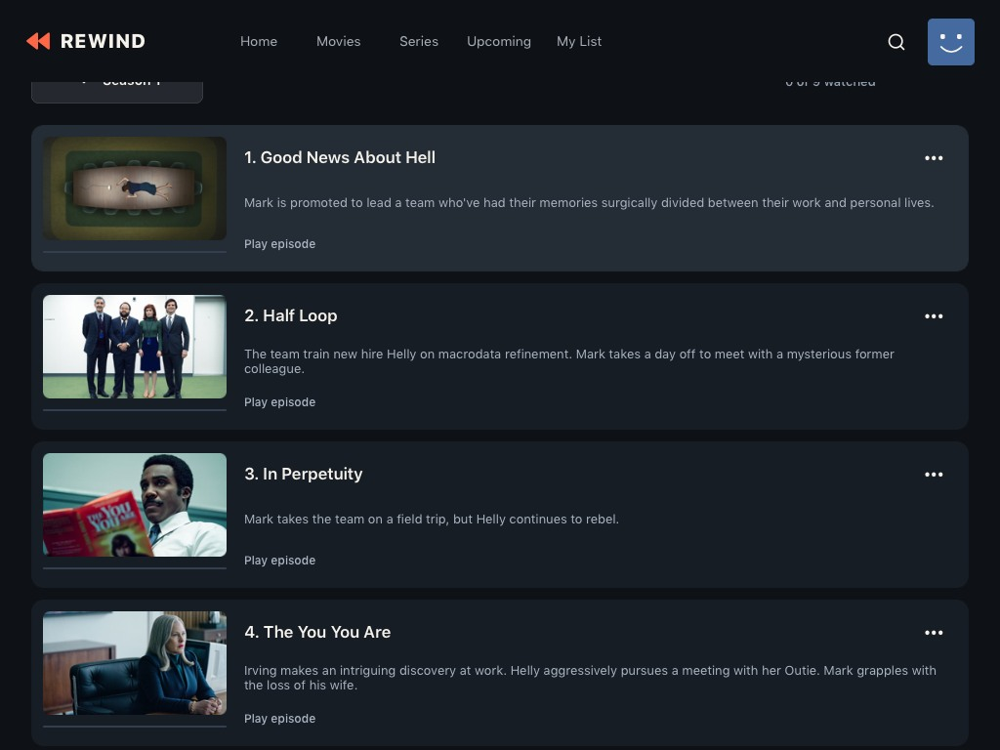
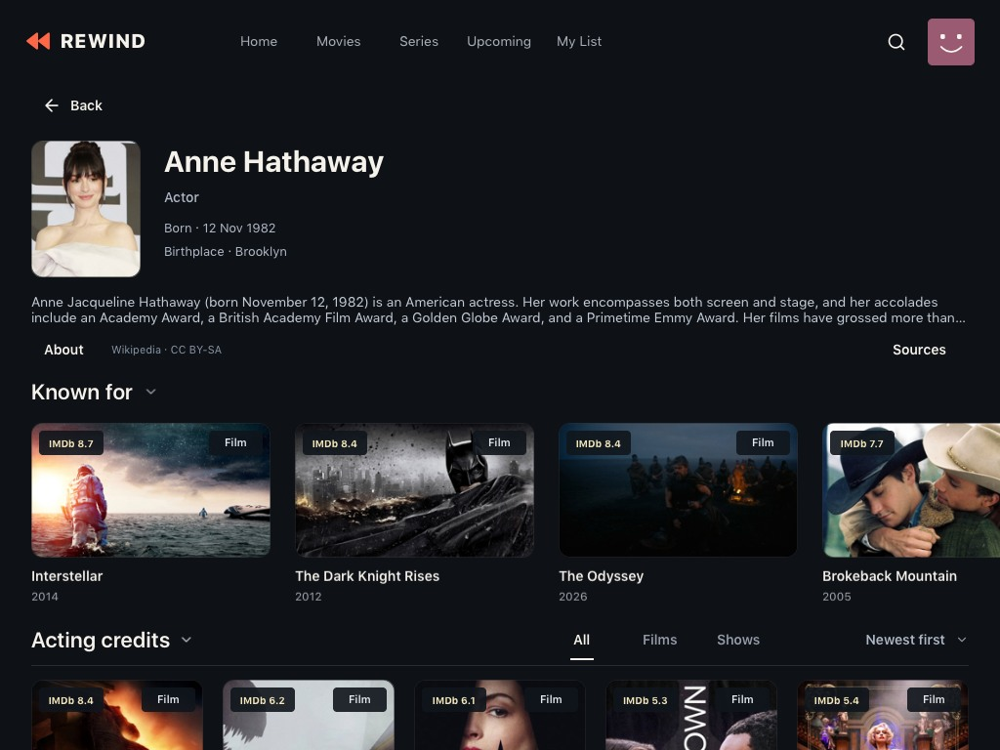
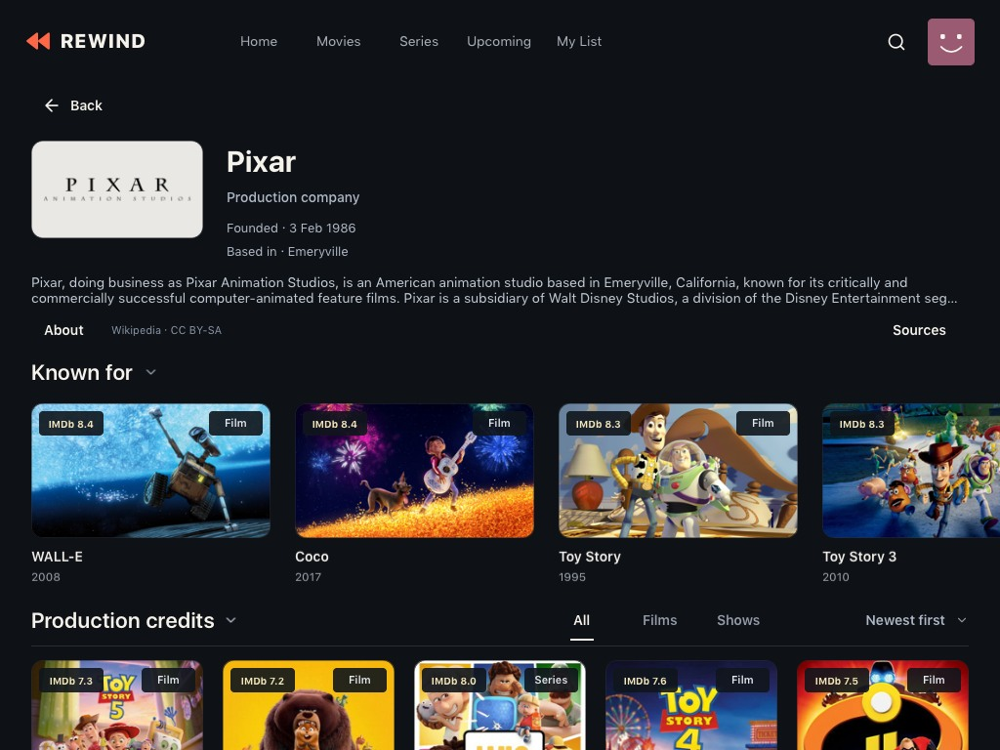

# Inside Rewind

The images below are real captures from the original iPad mini, taken during development. They are not newly fabricated screens or proof of current source availability. Full frames are retained; exported JPEGs remove image metadata and reduce download size.

## A quick tour

This is an animated **sequence of screenshots**, not a live recording or a loading-speed demonstration. It walks through profiles, browsing, title details, episodes and cast.

## Choose a profile

Regular and Kids profiles have separate preferences, lists and viewing progress. The picker below uses the generic Main and Kids profiles; the Kids example has a configured age limit.

## Discover and browse

Movies use horizontal shelves with visible ratings and media types. Series have their own destination; Kids content uses the selected profile's age limit and available rating evidence.

## Open a title and choose an episode

Details combine artwork, title information and playback actions. Series expose seasons and episodes inside the same view. Native trailers play when a compatible preview is available; this still image does not demonstrate trailer playback.

## Explore the people and studios

People pages connect biography, credits and related work. Studio pages provide a similar path into a filmography.

## Capture provenance

| Image | App checkpoint | Context |
| --- | --- | --- |
| Profiles | 0.156 | Profile selection on the physical iPad |
| Movies and Kids shelves | 0.229 | Settled horizontal browsing views |
| Series details and episodes | 0.229 | Series detail and episode navigation |
| Person and studio pages | 0.230 | Entity-page layout and artwork checks |

The cover and share card frame the same series capture with Rewind branding. The logo follows the app's double-chevron navigation mark. Original capture checksums and image dimensions are recorded in [capture-provenance.json](assets/capture-provenance.json). No private device logs or profile exports are included.

Film and series imagery, actor photographs, studio/publisher marks and metadata retain their original rights. They are shown to document the interface; the MIT license does not cover those third-party works. See [third-party notices](../THIRD_PARTY_NOTICES.md).
